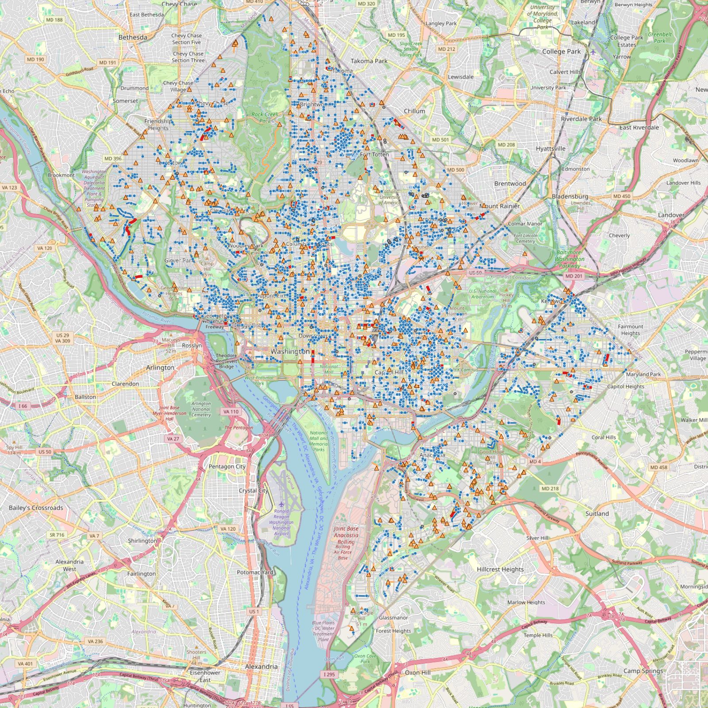

# CS12 Data Scientist, GIS Test: Roadway Subblock enrichment (QGIS)

This QGIS project answers the Deputy Chief of the Maintenance Operations Administration's
data request. It enriches the DDOT **Roadway Subblock** centerlines with:
- excavation and paving **permit renewals**
- open roadway **Cityworks service requests**
- their latest dates

It also includes a version of the permit data **snapped to the roadway**.

Built with **QGIS 4.2.3** (Python + Processing). Data pulled from the DC GIS REST services on
**2026-11-09**.

## Results

| Measure | Value |
|---|---:|
| Filtered permits (issued renewals, excavation or paving, expiring on or after 10/1/2025) | **10,008** |
| …snapped to a street, service lane or ramp and counted | 9,934 |
| …on alleys, driveways or walkways (snapped, not counted) | 74 |
| Filtered Cityworks SRs (provided definition query) | **653** (643 assigned to a block) |
| Street / service road / ramp subblocks | **23,104** |
| Blocks with permits | 2,525 |
| Blocks with service requests | 541 |
| **Blocks with both permits and SRs** (`BOTH_FLAG = 1`) | **98** |



## Deliverables checklist

| Requirement (from the PDF) | Where it is |
|---|---|
| Packaged QGIS project | `CS12_Roadway_Enrichment.qgz` (relative paths; open it from the unzipped folder) |
| Local geodatabase version of Roadway Subblock, enriched | `data/output/CS12_Roadway_Enrichment.gpkg` → layer **`roadway_subblock_enriched`** |
| ▪ Count of permits per subblock | `PRMT_CNT` |
| ▪ Max expiration date among permits | `PRMT_MAXEX` |
| ▪ Count of service requests per subblock | `SR_CNT` |
| ▪ Max initiated date among service requests | `SR_MAXINIT` |
| ▪ Flags for blocks with both | `BOTH_FLAG` (plus `HAS_PRMT`, `HAS_SR`, `FLAG_CAT`); subset layer `roadway_subblock_permits_and_sr` |
| Local geodatabase version of the filtered permits, snapped to the roadway | layer **`permits_filtered_snapped`** (QA: `permits_filtered_original`, `permit_snap_lines`) |
| REST feeds for permits, Cityworks and Roadway Subblock loaded on the map | Project group **"REST service feeds (DC GIS, live)"** |
| Geoprocessing history | GeoPackage table **`geoprocessing_history`** (loaded in the project), `docs/geoprocessing_history.md` and `.json` |
| Additional tables, files and scripts | `summary_*` tables, `data/output/shapefiles/`, `scripts/`, `docs/` |

The GeoPackage (`.gpkg`) is the QGIS / OGC equivalent of an ArcGIS file geodatabase. ArcGIS
Pro can open it directly.

## Folder layout

```
CS12_Roadway_Enrichment.qgz          QGIS project: open this
README.md                            this file
MANUAL_BUILD_GUIDE.md                step-by-step GUI instructions (shapefiles or from scratch)
run_all.bat                          re-runs the whole pipeline
data/
  raw/raw_downloads.gpkg             untouched REST downloads (EPSG:26985) + download_log.json
  output/CS12_Roadway_Enrichment.gpkg   all results (the local "geodatabase")
  output/shapefiles/*.shp            shapefile copies of every result layer
docs/
  APPROACH.md                        data findings, filter logic, snapping method, assumptions
  geoprocessing_history.md / .json   every download + Processing call, with parameters
  validation_summary.txt             reconciliation checks
  map_preview_*.png                  rendered previews
scripts/
  01_download.py                     paged ArcGIS REST download → GeoPackage
  02_process.py                      filters, snapping, assignment, aggregation, enrichment, shapefiles
  03_validate.py                     counts and geometric checks
  04_build_project.py                builds the .qgz, styles, REST layers, history table
  05_render_preview.py               PNG previews
  qgis_env.py                        headless QGIS bootstrap + history logger
  explore_*.py, diag_snap_distance.py   data profiling used to choose filters and tolerances
```

## Opening the project

1. Unzip the folder anywhere.
2. Double-click `CS12_Roadway_Enrichment.qgz`, or use QGIS **Project > Open**.
3. The results group is on by default.
   - The REST feeds group is **off** by default because those layers are live and large.
     Tick a layer to load it. Cityworks only draws when zoomed in below 1:25,000.
4. **Identify** a red block to see its counts and dates.
   - Or open the attribute table of `roadway_subblock_enriched` and filter
     `"BOTH_FLAG" = 1`.

## Method summary

Full details are in [docs/APPROACH.md](docs/APPROACH.md).

1. **Download.** All three layers are pulled from the REST services in EPSG:26985, so
   distances are in metres. Downloads use object-ID paging past the 2,000-record limit.
2. **Filter.** QGIS *Extract by expression* applies the Data Requirements:
   - Permits: `Renewal` + `Issued` + Excavation/Paving + `ExpirationDate >= 2025-10-01`.
   - Subblocks: `ROADTYPE` 1 Street / 2 Service Road / 3 Ramp.
   - Cityworks: the provided definition query.
3. **Snap permits.**
   - Permit points sit on the MAR street-segment network, about 0.7 m off the subblock
     centerlines.
   - *Join attributes by nearest* (10 m) finds the closest point on the nearest
     street / service / ramp subblock.
   - *Geometry by expression* moves each point there.
   - Alley and driveway permits fall back to their nearest alley or driveway line and are
     not counted.
4. **Assign SRs.** *Join attributes by nearest* (50 m) assigns each service request to a
   subblock.
5. **Aggregate and enrich.**
   - *Aggregate* computes the count and maximum date per subblock.
   - *Join attributes by field value* attaches them to the subblocks.
   - *Refactor fields* fills zero counts and adds the flags.
6. **Validate.**
   - The sum of block counts equals the number of counted points: 9,934 permits and
     643 SRs.
   - Every snapped permit lies within 1 cm of its block.
   - No permit appears twice.

## Re-running

Requires QGIS (OSGeo4W build). Edit `QGIS_BIN` in `run_all.bat` if QGIS isn't installed at
`X:\QGIS`, then run `run_all.bat`. It refreshes the data from the live REST services and
rebuilds everything.
